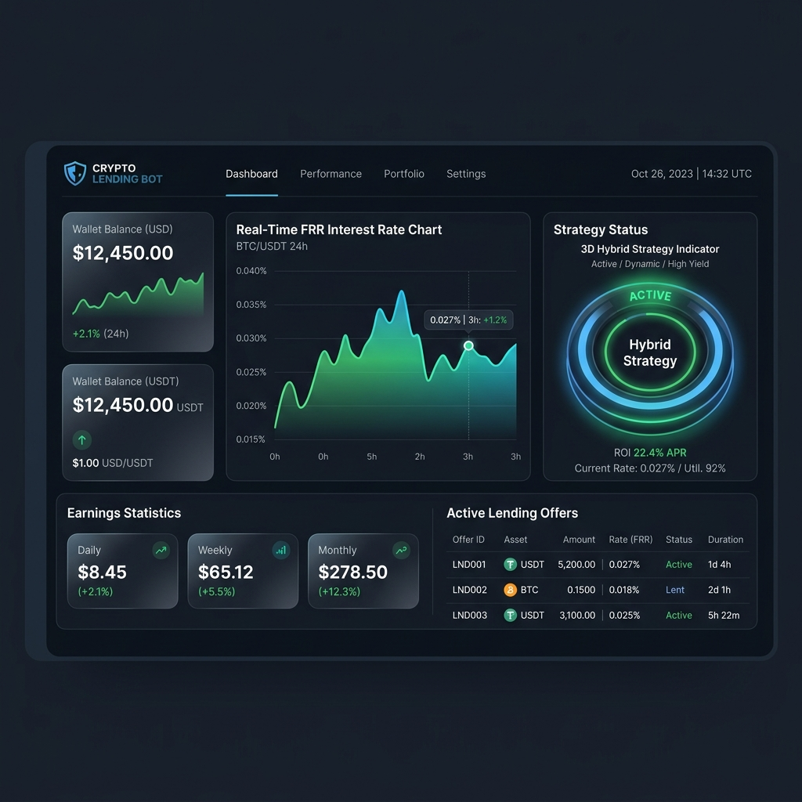
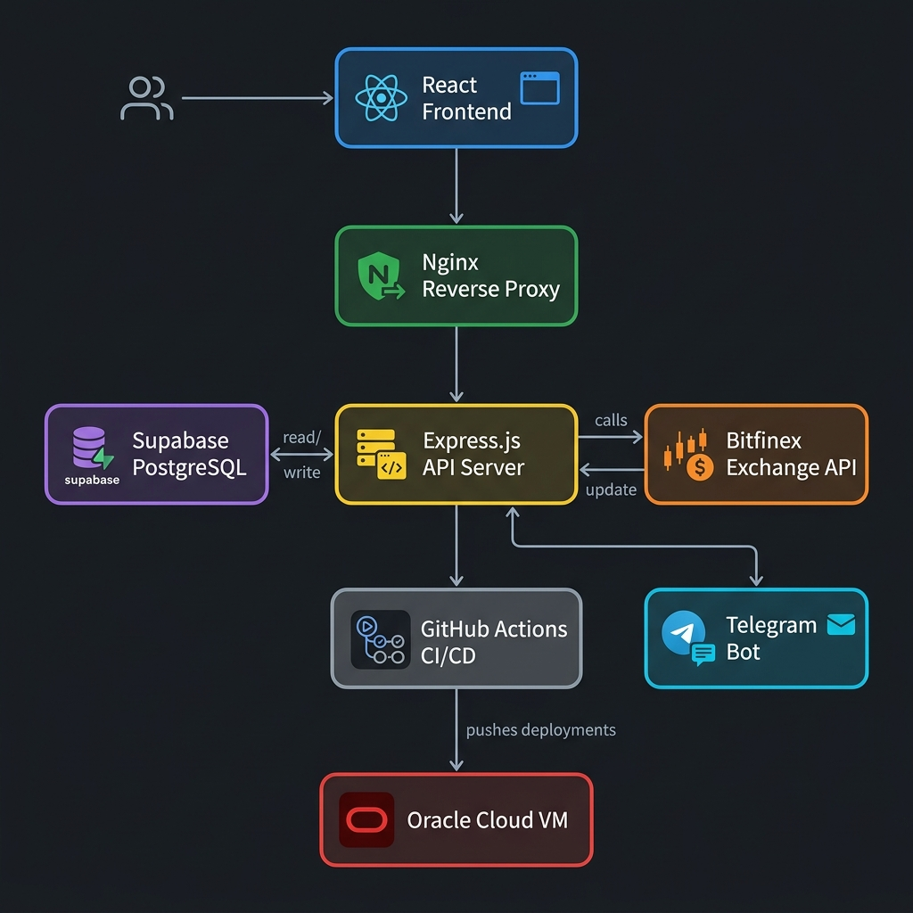
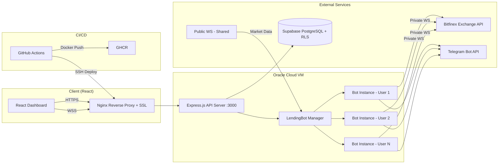
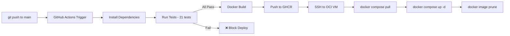
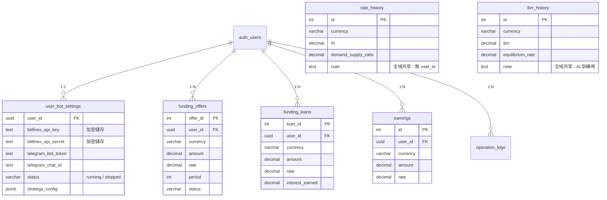
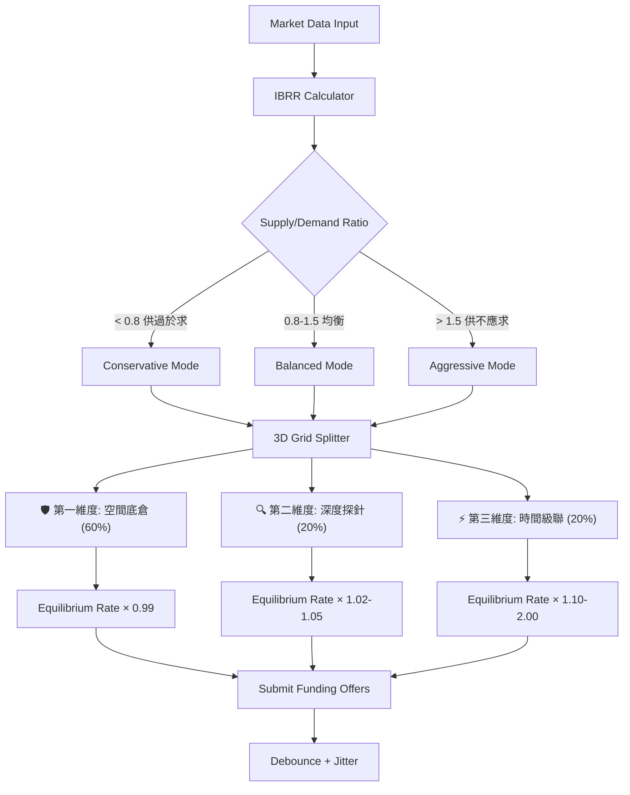

<p align="center">
  <h1 align="center">🏦 Bitfinex Lending Bot — Multi-Tenant SaaS Platform</h1>
  <p align="center">
    <strong>全自動加密貨幣放貸機器人，搭載 3D Hybrid 自適應策略引擎</strong>
  </p>
</p>

<p align="center">
  
  
  
  
  
  
  
  
  
</p>

---

## 📸 Dashboard 預覽

<p align="center">
  
</p>

> 全 Dark Mode 即時儀表板：即時 FRR 利率走勢圖、錢包餘額、活躍放貸合約、收益統計熱力圖、3D Hybrid 策略診斷面板。

---

## ✨ 功能亮點 (Features)

### 🤖 核心交易引擎
- **3D Hybrid 自適應策略** — 三維網格拆單（底倉 60% / 深度探針 20% / 時間級聯 20%），根據即時訂單簿深度與供需比動態調整
- **IBRR 即時最佳利率計算** — 結合瓦爾拉斯均衡 (Walrasian Equilibrium) + 訂單簿分析，自動過濾莊家釣魚假單 (Spoofing Filter)
- **事件驅動 + 定時混合決策** — WebSocket 即時捕捉錢包/掛單變動，搭配 10 秒定時決策週期，兼顧反應速度與穩定性
- **防抖 (Debounce) + 流量交錯 (Jitter & Staggering)** — 避免多用戶在同一秒內併發爆 API Rate Limit
- **自動複利再投 (Compounding)** — 貸款到期利息自動滾入下次放貸，最大化資金利用率

### 👥 多租戶 SaaS 架構
- **Google OAuth 一鍵登入** — 透過 Supabase Auth 整合 Google 帳號登入，零密碼體驗
- **Per-User 獨立 Bot 實例** — 每位用戶擁有獨立的 `LendingBot` 實例，策略、設定、WebSocket 完全隔離
- **Row Level Security (RLS)** — 資料庫層級強制資料隔離，即使後端程式碼有 bug 也無法跨用戶存取
- **容器重啟自動恢復** — `autoResumeAll()` 機制確保 Docker 重啟後，所有活躍用戶的 Bot 自動恢復運行

### 📊 即時監控儀表板
- **React 前端** — 10 個專業級組件：狀態面板、利率走勢圖、收益統計、歷史紀錄、收益熱力圖、日誌檢視器、策略診斷面板、用戶設定頁
- **WebSocket 即時推播** — JWT 認證的 WS 連線，每 2 秒推送用戶專屬的 Bot 運行狀態
- **Telegram 即時通知** — 每位用戶可配置自己的 Telegram Bot，成交/警報/每日摘要自動推播

### 🔒 安全性 & DevOps
- **API Key 加密儲存** — Supabase `pgsodium` 資料庫級對稱加密保護用戶交易所金鑰
- **Nginx + Let's Encrypt 自動 SSL** — 生產環境全 HTTPS，TLS 終止 + 反向代理
- **CI/CD 全自動化** — `git push` → GitHub Actions → 測試 → Docker Build → GHCR → SSH 部署至 OCI VM
- **Prometheus 監控指標** — `/metrics` 端點暴露放貸餘額、活躍合約數等自訂指標

---

## 🏗️ 系統架構 (System Architecture)

<p align="center">
  
</p>



### 關鍵設計決策

| 設計點 | 做法 | 理由 |
|--------|------|------|
| **公有/私有 WS 分離** | 1 個共享公開 WS + 每用戶 1 個私有 WS | 公開行情不需重複訂閱，私有帳戶事件必須隔離 |
| **全域行情收集器** | 單一定時器寫入 `rate_history` / `ibrr_history` | 避免 N 位用戶重複寫入相同的市場快照 |
| **LendingBot 生命週期** | `manager.js` Map 管理 | 啟動/停止/恢復/關閉 統一入口，容器重啟自動恢復 |

---

## 🛠️ Tech Stack & 選型理由

| 層級 | 技術 | 為什麼選它 |
|------|------|-----------|
| **Frontend** | React 18 + Vite | 最成熟的 SPA 生態系，HMR 極速開發，面試官幾乎都會 |
| **Backend** | Express 5 (Node.js 20) | 輕量、生態成熟、原生支持 WebSocket，非阻塞 I/O 天生適合即時交易 |
| **Database** | Supabase (PostgreSQL 15) | 內建 Auth + RLS + Realtime，免維護的 Managed Postgres |
| **Auth** | Supabase Auth (Google OAuth) | 零後端程式碼即可完成第三方登入，JWT 自動簽發 |
| **WebSocket** | `ws` (原生) | 零依賴、最低延遲，不需 Socket.io 的 fallback 機制 |
| **Telegram** | `node-telegram-bot-api` | 最廣泛使用的 Node.js Telegram SDK |
| **Process Manager** | Docker `restart: unless-stopped` | 容器級別的進程守護，比 PM2 更貼近 production 實踐 |
| **Reverse Proxy** | Nginx (via nginxproxy/nginx-proxy) | 自動 Virtual Host 路由 + Let's Encrypt SSL 自動續簽 |
| **CI/CD** | GitHub Actions | 與 GitHub 深度整合，免費額度足夠 side project |
| **Monitoring** | Prometheus (`prom-client`) | 業界標準，可串接 Grafana 儀表板 |
| **Testing** | Vitest + Supertest | 與 Vite 同生態系，速度比 Jest 快 5-10x |
| **Cloud** | Oracle Cloud (ARM VM) | Always Free Tier 提供 4 OCPU + 24GB RAM，性價比最高 |

### 技術選型對比

| 需求 | 我選擇的 | 沒選的替代方案 | 理由 |
|------|----------|---------------|------|
| Database + Auth | **Supabase** | Firebase | Supabase 底層是標準 PostgreSQL，支援 RLS、SQL 查詢、Foreign Key，遠比 Firestore 的 NoSQL 模型適合金融資料 |
| Backend Framework | **Express 5** | NestJS / Fastify | Express 生態最大、學習曲線最低；Fastify 效能更好但 plugin 生態較小；NestJS 太重量級 |
| 進程管理 | **Docker** | PM2 | 容器化是現代部署標準，一個 `docker compose up` 包含 App + Nginx + SSL，比 PM2 + systemd 更可攜 |
| 即時通訊 | **原生 WS** | Socket.io | 不需要 long-polling fallback，交易所 API 本身就是 WebSocket，多一層 Socket.io 只增加延遲 |
| Cloud | **OCI** | AWS / GCP | OCI Always Free ARM VM (4 OCPU + 24GB RAM) 遠超 AWS t2.micro (1 vCPU + 1GB) |

---

## 🔒 安全性與合規 (Security & Compliance)

| 安全層級 | 措施 | 說明 |
|----------|------|------|
| **傳輸層** | TLS 1.3 (Let's Encrypt) | Nginx 自動 SSL 終止 + ACME 自動續簽 |
| **認證** | Supabase JWT (Google OAuth) | 無密碼登入，Token 自動刷新 |
| **授權** | Row Level Security (RLS) | PostgreSQL 層級強制資料隔離，5 張表全部啟用 |
| **API 金鑰保護** | `pgsodium` 對稱加密 | 用戶的交易所 API Key/Secret 以資料庫級加密儲存，前端只顯示遮蔽值 |
| **Secrets 管理** | GitHub Actions Secrets → `.env` → Docker `--env-file` | 金鑰永遠不進 Git，全鏈路注入 |
| **防暴力破解** | Supabase 內建 Rate Limiting | 登入嘗試次數限制 |
| **最小權限原則** | Bitfinex API 僅開放 Wallet Read + Margin Funding Write | 建議用戶切勿開放 Withdrawal 權限 |
| **資料防洩** | `requireUserId()` Guard | 所有租戶相關 DB 函數若忘記傳 userId 會觸發 warning log |

---

## 🔄 CI/CD Pipeline



**部署流程**：一次 `git push` 即完成測試 → 建置 → 推送 → 部署。失敗的測試會自動阻擋部署，確保生產環境穩定。

---

## 🗄️ Database Schema (Multi-Tenant)



**設計原則**：
- **Per-User 表** (有 `user_id`)：`funding_offers`、`funding_loans`、`earnings`、`operation_logs`、`user_bot_settings` — 全部啟用 RLS
- **全域共享表** (無 `user_id`)：`rate_history`、`ibrr_history`、`order_book_snapshots`、`bot_settings` — 市場行情數據全用戶共享

---

## 🧠 3D Hybrid 策略引擎



| 維度 | 佔比 | 策略邏輯 | 目標 |
|------|------|---------|------|
| 🛡️ 底倉 | 60% | 在均衡利率附近掛單，快速成交 | 確保資金利用率 |
| 🔍 深度探針 | 20% | 高於均衡利率 2-5%，探測訂單簿深處的需求 | 捕捉中溢價機會 |
| ⚡ 時間級聯 | 20% | 高於均衡利率 10-100%，設定天價掛單 | 捕捉極端行情爆發 |

---

## 🚀 Getting Started

### 前置需求

- Node.js 20+
- Docker & Docker Compose
- Supabase 專案 (免費 tier 即可)
- Bitfinex 帳號 + API Key (需開放 Wallet Read + Margin Funding 權限)

### 方式一：本機開發 (Quick Start)

```bash
# 1. Clone 專案
git clone https://github.com/ian32253188/Lending-bot.git
cd Lending-bot

# 2. 安裝依賴
npm install
cd client && npm install && cd ..

# 3. 設定環境變數
cp .env.example .env
# 編輯 .env 填入 Supabase URL/Key/AnonKey、JWT_SECRET

# 4. 建置前端
npm run client:build

# 5. 啟動
npm start
# 伺服器啟動於 http://localhost:3000
```

### 方式二：Docker Compose (推薦)

```bash
# 1. 設定環境變數
cp .env.example .env
# 編輯 .env

# 2. 一鍵啟動
cd deploy
docker compose up -d
# 伺服器啟動於 http://localhost:3000
```

### 方式三：OCI 生產部署 (含 Nginx + SSL)

```bash
# 1. 在 OCI VM 上 Clone 專案
git clone https://github.com/ian32253188/Lending-bot.git
cd Lending-bot

# 2. 設定環境變數 (含 DOMAIN_NAME 和 LETSENCRYPT_EMAIL)
cp .env.example .env
nano .env

# 3. 啟動生產環境 (含 Nginx + Let's Encrypt 自動 SSL)
cd deploy
docker compose -f docker-compose.prod.yml up -d

# 服務啟動後，Nginx 會自動申請 SSL 證書
# 存取 https://your-domain.com 即可
```

### 資料庫初始化

```bash
# 將 supabase/migrations/ 下的 SQL 檔按順序執行：
# 001_initial.sql          — 基礎表結構
# 002_orderbook_snapshots.sql — 訂單簿快照表
# 003_ibrr_history.sql     — IBRR AI 訓練歷史表
# 004_multi_tenant_saas.sql — 多租戶 RLS + user_bot_settings
```

---

## 🧪 Testing

本專案使用 **Vitest** + **Supertest** 進行自動化測試，涵蓋策略引擎、資料庫整合、API 端點、日誌系統。

```bash
# 執行所有測試
npm test

# Watch 模式
npm run test:watch
```

### 測試檔案詳細說明

| 測試檔 | 測試數 | 涵蓋內容 |
|--------|--------|---------|
| `strategy.test.ts` | 7 | 3D Hybrid 核心演算法：IBRR 均衡利率計算、莊家釣魚假單過濾 (Spoofing Age Filter)、極端供需情境處理、三維拆單金額精準度驗證、最低金額邊界條件 |
| `api.test.ts` | 5 | API 端點整合測試：健康檢查 (`/api/health`)、Prometheus 指標格式驗證 (`/metrics`)、未認證請求 401 拒絕、SPA Fallback 路由 |
| `database.test.ts` | 3 | Supabase 資料庫整合：掛單寫入/關閉 (saveOffer/closeOffer)、日誌寫入 (saveLog)、**測試數據自動清理**（確保不污染生產資料庫） |
| `ml-predictor.test.ts` | 2 | Phase 2 AI 預測器：ML 權重模型載入驗證、歷史數據不足時的統計模型 Fallback |
| `logger.test.ts` | 2 | 日誌系統：Production 模式輸出 structured JSON、Development 模式輸出 human-readable 格式 |
| `reoffer.test.ts` | 2 | 自動降息重掛模組：荷蘭拍衰減機制 (Dutch Auction Decay)、保底利率 Floor 觸發 |

**最新測試結果**：
```
 ✓ server/services/analysis/reoffer.test.ts    (2 tests)
 ✓ server/utils/logger.test.ts                  (2 tests)
 ✓ server/services/engine/ml-predictor.test.ts  (2 tests)
 ✓ server/services/engine/strategy.test.ts      (7 tests)
 ✓ server/routes/api.test.ts                    (5 tests)
 ✓ server/services/database.test.ts             (3 tests)

 Test Files  6 passed (6)
      Tests  21 passed (21)
   Duration  1.33s
```

---

## 📁 專案結構

```
Lending-bot-master/
├── .github/workflows/
│   └── deploy.yml              # CI/CD: Test → Build → Push → Deploy
├── client/
│   └── src/
│       ├── components/
│       │   ├── Dashboard.jsx       # 主儀表板 (Tab 導航)
│       │   ├── StatusPanel.jsx     # 即時狀態面板
│       │   ├── RateChart.jsx       # FRR 利率走勢圖
│       │   ├── EarningsPanel.jsx   # 收益統計 (日/週/月/年)
│       │   ├── HeatmapView.jsx     # 收益熱力圖
│       │   ├── StrategyPanel.jsx   # 3D Hybrid 策略診斷
│       │   ├── HistoryPage.jsx     # 歷史掛單/貸款紀錄
│       │   ├── LogViewer.jsx       # 操作日誌檢視器
│       │   ├── SettingsPanel.jsx   # 用戶設定 (API Key/Telegram)
│       │   └── Login.jsx           # Google OAuth 登入
│       ├── hooks/useWebSocket.js   # JWT-authenticated WS Hook
│       └── App.jsx                 # Supabase Client 初始化 + Auth 狀態管理
├── server/
│   ├── config/index.js             # 環境變數集中管理 + 驗證
│   ├── middleware/auth.js          # Supabase JWT 認證中間件
│   ├── routes/
│   │   ├── auth.js                 # /api/auth — Supabase 設定 & Token 驗證
│   │   ├── dashboard.js            # /api/dashboard — 收益/歷史/利率 API
│   │   └── lending.js              # /api/lending — 設定/引擎控制/手動掛單
│   ├── services/
│   │   ├── bitfinex/
│   │   │   ├── rest.js             # Bitfinex REST API (掛單/取消/錢包)
│   │   │   └── ws.js               # Public WS (行情) + Private WS (帳戶)
│   │   ├── engine/
│   │   │   ├── lending.js          # LendingBot 類別 — 核心放貸邏輯
│   │   │   ├── manager.js          # 多用戶 Bot 生命週期管理
│   │   │   ├── strategy.js         # 3D Hybrid 策略引擎 + IBRR 計算
│   │   │   └── ml-predictor.js     # Phase 2 AI 預測模組
│   │   ├── analysis/cleanup.js     # 每日 3:00 AM 日誌自動清理
│   │   ├── database.js             # Supabase CRUD (含 userId Guard)
│   │   ├── telegram.js             # 多租戶 Telegram Bot 管理
│   │   └── metrics.js              # Prometheus 監控指標
│   └── utils/logger.js             # 結構化日誌 (JSON/Human-readable)
├── deploy/
│   ├── docker-compose.yml          # 開發環境
│   ├── docker-compose.prod.yml     # 生產環境 (Nginx + SSL + ACME)
│   └── setup.sh                    # OCI VM 初始化腳本
├── supabase/migrations/
│   ├── 001_initial.sql             # 基礎表結構
│   ├── 002_orderbook_snapshots.sql # 訂單簿快照
│   ├── 003_ibrr_history.sql        # IBRR 歷史 (AI 訓練用)
│   └── 004_multi_tenant_saas.sql   # 多租戶 RLS + 用戶設定表
├── Dockerfile                      # Multi-stage Node.js 建置
├── .env.example                    # 環境變數範本
└── package.json
```

---

## 🗺️ Roadmap

| 階段 | 功能 | 狀態 |
|------|------|------|
| ✅ Phase 1 | 核心放貸引擎 + 3D Hybrid 策略 + Dashboard | 完成 |
| ✅ Phase 1.5 | 多租戶 SaaS 升級 (Google Auth + RLS + Per-User Bot) | 完成 |
| ✅ Phase 1.6 | Nginx + SSL + CI/CD + OCI 部署 | 完成 |
| 🔄 Phase 2 | ML 利率預測模型 (LSTM / Transformer) + 回測系統 | 開發中 |
| 📋 Phase 3 | 多交易所支持 (OKX / Binance Earn) | 規劃中 |
| 📋 Phase 4 | 付費訂閱制 (Stripe) + Landing Page | 規劃中 |

---

## ⚖️ Disclaimer

> 本專案為**個人學習與技術展示**用途，非財務建議或投資推薦。加密貨幣放貸涉及資金風險，使用者應自行評估風險並承擔一切後果。作者不對任何因使用本軟體而產生的損失負責。

---

<p align="center">
  Built with ☕ & 🎵 by <a href="https://github.com/ian32253188">Ian</a>
</p>
